# CloudOps Sentinel

CloudOps Sentinel is a local operations demonstration of metrics, SLO alerting, tracing and incident response.

[](https://github.com/siiick-brain/cloudops-sentinel/actions/workflows/ci.yml)

## Problem

Teams need to connect service health signals to operational response. This project shows how service metrics, traces and SLO alerts can help identify faults. The local chaos runner exercises those signals. Slack and Jira use local mocks by default.

## Architecture

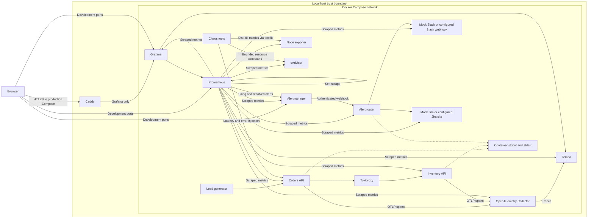

In the production-style Compose configuration Caddy is the only service that publishes host ports. The development configuration publishes service ports for local testing.

## Quick start

Run these three commands from a clean clone in PowerShell. Docker Compose and Python are required.

```powershell
Copy-Item .env.example .env
py -m venv .venv; .\.venv\Scripts\python.exe -m pip install -r requirements-dev.txt
powershell.exe -NoProfile -ExecutionPolicy Bypass -File .\scripts\demo.ps1
```

Expected output: one line per step. The demo starts the stack, waits for every target, sends traffic, checks a trace that spans both services, runs the latency chaos scenario, checks the alert in Prometheus and Alertmanager plus the message in mock Slack and the ticket in mock Jira, then prints Compose status. The demo always uses the mocks, even when `.env` holds real credentials.

## How it works

### Metrics and dashboards as code

The API and inventory services expose Prometheus request counters and latency histograms. Prometheus scrapes application and infrastructure targets. Python definitions using the Grafana Foundation SDK generate provisioned dashboards for golden signals, SLOs, node and container health and traces.

### SLOs and burn-rate alerts

The SLOs live in [monitoring/prometheus/slo.yml](monitoring/prometheus/slo.yml). `scripts/generate_slo_rules.py` turns them into recording rules and multi-window multi-burn-rate alerts. CI fails if the generated file drifts. The error budget policy is in [docs/slo.md](docs/slo.md).

| SLO | Objective | Window | Error budget | Page (critical) | Ticket (warning) |
|---|---|---|---|---|---|
| API availability | 99.5 percent of requests return non-5xx | 30 days | 0.5 percent, about 3.6 hours | 14.4x burn over 5m and 1h | 6x burn over 30m and 6h |
| API latency | 95 percent of requests under 300 ms | 30 days | 5 percent of requests | 14.4x burn over 5m and 1h | 6x burn over 30m and 6h |

promtool unit tests check that each burn-rate alert fires at its burn rate and stays quiet below it.

### Alert routing to Slack and Jira

Prometheus sends firing and resolved notifications to Alertmanager. Alertmanager groups them and sends an authenticated webhook per group to the router. The router opens one Jira issue per group, deduplicates by a fingerprint label, comments on repeat firings, closes the issue on resolve and sends Slack Block Kit messages. See [Integrations](#integrations).

### Tracing

The API calls inventory through Toxiproxy. Both services export OpenTelemetry spans to the collector and then to Tempo. API latency histogram exemplars link to traces in Grafana.

### Chaos experiments

The runner injects API latency and errors, stops the inventory service or applies bounded CPU, memory, disk and network faults. It checks the expected alert and integrations, records elapsed times and exits unsuccessfully when a required check fails.

## Alerts

Every alert carries severity, summary, description and a `runbook_url` annotation. A unit test fails if an alert has no matching runbook file or its link points anywhere else.

| Alert | Severity | Service | For | Summary |
|---|---|---|---|---|
| [ApiAvailabilityBurnCritical](docs/runbooks/ApiAvailabilityBurnCritical.md) | critical | api | 2m | API availability is burning the error budget quickly |
| [ApiAvailabilityBurnWarning](docs/runbooks/ApiAvailabilityBurnWarning.md) | warning | api | 5m | API availability is consuming the error budget |
| [ApiLatencyBurnCritical](docs/runbooks/ApiLatencyBurnCritical.md) | critical | api | 2m | API latency is burning the latency budget quickly |
| [ApiLatencyBurnWarning](docs/runbooks/ApiLatencyBurnWarning.md) | warning | api | 5m | API latency is consuming the latency objective budget |
| [ApiHighErrorRate](docs/runbooks/ApiHighErrorRate.md) | warning | api | 30s | API error rate is above 5 percent |
| [ApiHighLatency](docs/runbooks/ApiHighLatency.md) | warning | api | 30s | API p95 latency is above 300 ms |
| [TargetDown](docs/runbooks/TargetDown.md) | critical | monitoring | 1m | A monitored target is down |
| [NodeDown](docs/runbooks/NodeDown.md) | critical | node | 1m | Node exporter target is down |
| [ChaosContainerCpuHigh](docs/runbooks/ChaosContainerCpuHigh.md) | warning | container | 1m | Chaos container CPU usage is high |
| [ChaosContainerMemoryHigh](docs/runbooks/ChaosContainerMemoryHigh.md) | warning | container | 1m | Chaos container memory use is high |
| [ChaosContainerDiskHigh](docs/runbooks/ChaosContainerDiskHigh.md) | warning | container | 30s | Chaos container filesystem is over 80 percent full |
| [NodeCpuHigh](docs/runbooks/NodeCpuHigh.md) | warning | node | 1m | Node CPU utilization is above 90 percent |
| [NodeMemoryHigh](docs/runbooks/NodeMemoryHigh.md) | warning | node | 1m | Node memory utilization is above 90 percent |
| [NodeDiskHigh](docs/runbooks/NodeDiskHigh.md) | warning | node | 5m | Node disk use is above 85 percent |
| [NodeDiskFillingSoon](docs/runbooks/NodeDiskFillingSoon.md) | warning | node | 30m | Node filesystem is predicted to fill within 24 hours |
| [PrometheusDown](docs/runbooks/PrometheusDown.md) | critical | prometheus | 1m | Prometheus target is unavailable |
| [AlertmanagerDown](docs/runbooks/AlertmanagerDown.md) | critical | alertmanager | 1m | Alertmanager target is unavailable |

Alertmanager routes by severity and service, groups by alert name, service and severity. It mutes API and inventory alerts while `NodeDown` fires. The maintenance silence is documented in [docs/alerting.md](docs/alerting.md).

## Integrations

CI and the demo use the mock Slack and Jira services. Real mode (`INTEGRATION_MODE=real` plus `chaos/run.py --live`) talks to Jira Cloud REST API v3 and a Slack incoming webhook. The router refuses to start if a variable is missing. Details are in [docs/integrations.md](docs/integrations.md). The live run was verified manually on the date in [docs/live-verification.md](docs/live-verification.md).

One latency exercise, taken from the mock receivers:

1. `ApiHighLatency` fires (p95 above 300 ms for 30 s). Alertmanager groups it and posts one webhook to the router.
2. The router posts the firing message to Slack:

   ```text
   *[WARNING] API p95 latency is above 300 ms*
   Service: api
   Value: 934.4ms
   [Dashboard] [Runbook] [Jira ticket]
   ```

3. It opens a Jira ticket with summary `[WARNING] ApiHighLatency`, labels `warning`, `api` and the group fingerprint `fp-63caf2f2f14a7f5e`. The description, in Atlassian Document Format, holds the summary, dashboard link, runbook link and the number of alerts in the group. A repeat firing adds a comment instead of a new ticket.
4. When the alert clears, the router comments `Resolved at 2026-11-24T11:38:06Z.`, moves the ticket to Done and sends `*[RESOLVED] API p95 latency is above 300 ms*` with the same buttons.

The live run on 2026-11-24 against real Slack and Jira:

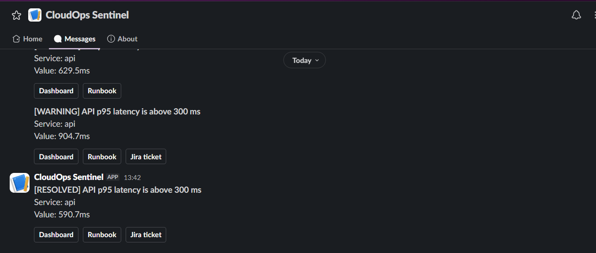

*Slack. The firing message (904.7 ms) and the resolved message for the same alert group.*

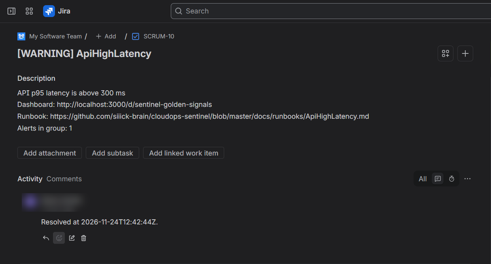

*Jira issue SCRUM-10, opened by the router and closed with a resolution comment. The commenter's name is blurred.*

## Results

All seven scenarios were run on 2026-11-24 against the mocks with `chaos/run.py`. Each run waits for steady state (the expected alert quiet and its last notification resolved), injects the fault, polls the Prometheus and Alertmanager APIs for the alert, then checks that the router delivered a Slack message and a Jira ticket. Raw results are written to `artifacts/chaos-results/`.

| Scenario | Expected alert | Alert after injection | Slack and Jira confirmed | Result |
|---|---|---:|---:|---|
| Latency, 600 ms injected | ApiHighLatency | 55.2 s | 73.8 s | Passed |
| Errors, 100 percent injected | ApiHighErrorRate | 55.2 s | 77.8 s | Passed |
| Inventory service stopped | TargetDown | 85.3 s | 104.2 s | Passed |
| Network delay, 700 ms via Toxiproxy | ApiHighLatency | 80.3 s | 102.1 s | Passed |
| CPU stress, stress-ng | ChaosContainerCpuHigh | 145.6 s | 161.3 s | Passed |
| Memory pressure, stress-ng 128 MiB | ChaosContainerMemoryHigh | 305.8 s | 324.5 s | Passed |
| Disk fill, 60 of 64 MiB | ChaosContainerDiskHigh | 45.1 s | 66.8 s | Passed |

Alert time includes the Prometheus rate window, each rule's `for` duration and the Alertmanager `group_wait` of 20 s. Memory pressure is slowest because the working set grows gradually. Slack and Jira are confirmed in the same poll, so the table shows one time for both.

## Screenshots

Captured on 2026-11-24 while 600 ms of latency and a 20 percent error rate were injected into the API. Every capture is listed with its command in the [image status list](docs/images/README.md).

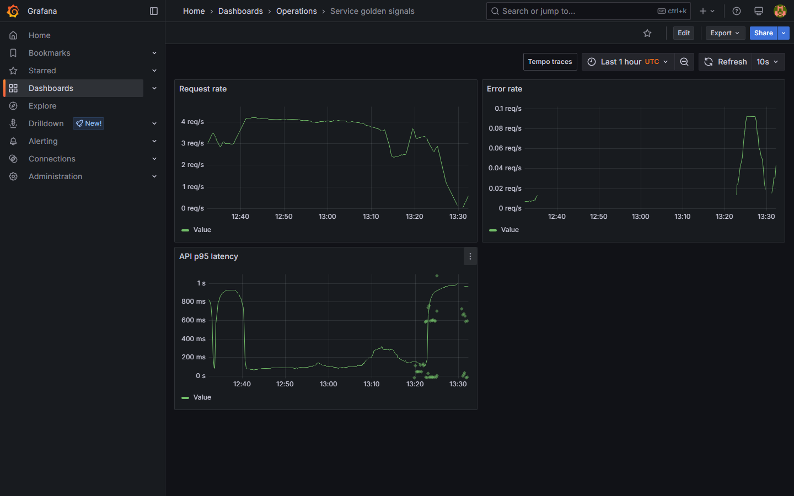

*Golden signals. p95 latency climbs past 900 ms and the error rate rises once the fault is injected.*

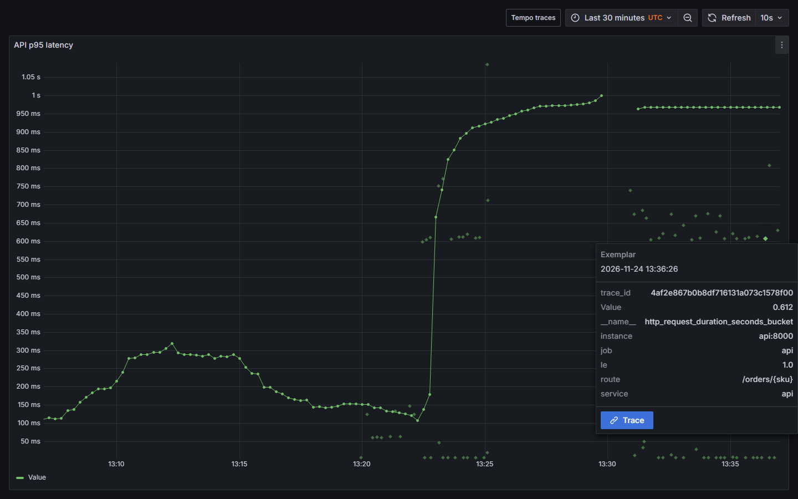

*An exemplar on the latency panel. The tooltip carries the trace ID of a 612 ms request and links straight to it in Tempo.*

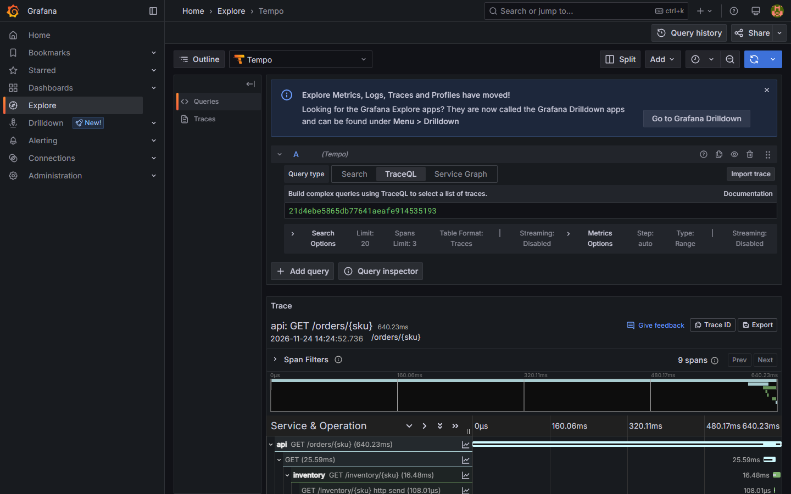

*One `GET /orders/{sku}` request in Tempo, from the API through Toxiproxy to the inventory service.*

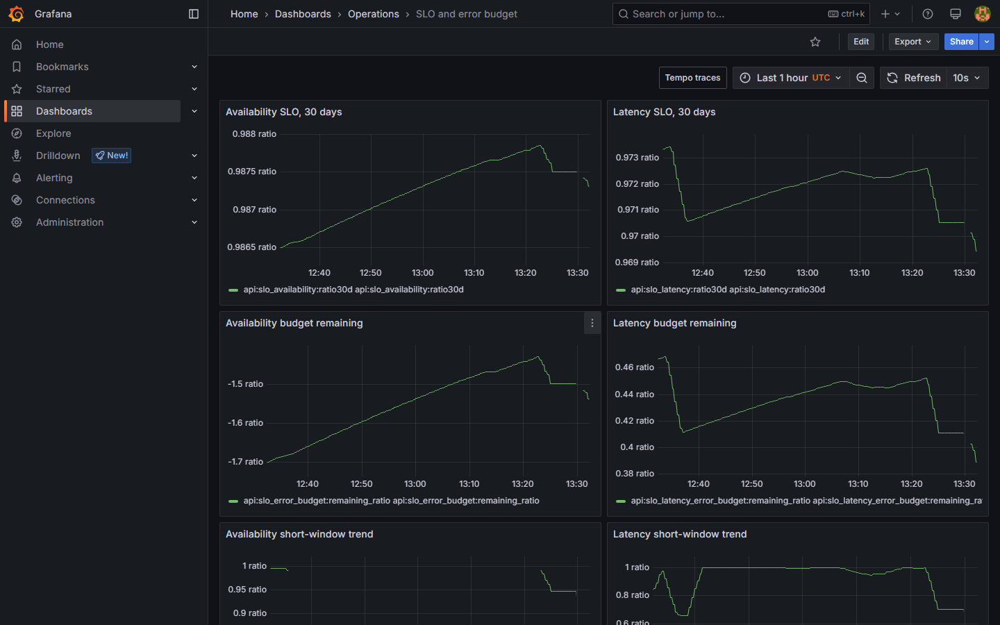

*SLOs and error budgets. The availability budget is below zero because the chaos exercises used it up.*

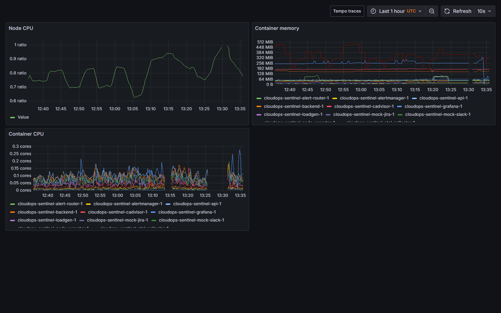

*Node CPU, plus memory and CPU for each container in the stack.*

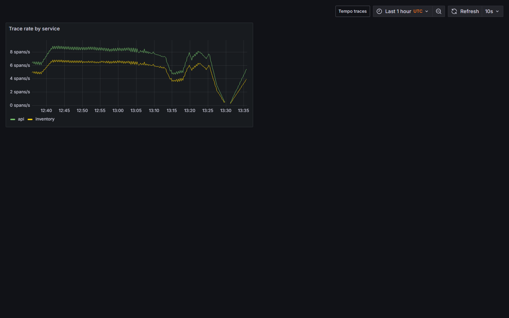

*Span rates per service from the collector's span metrics.*

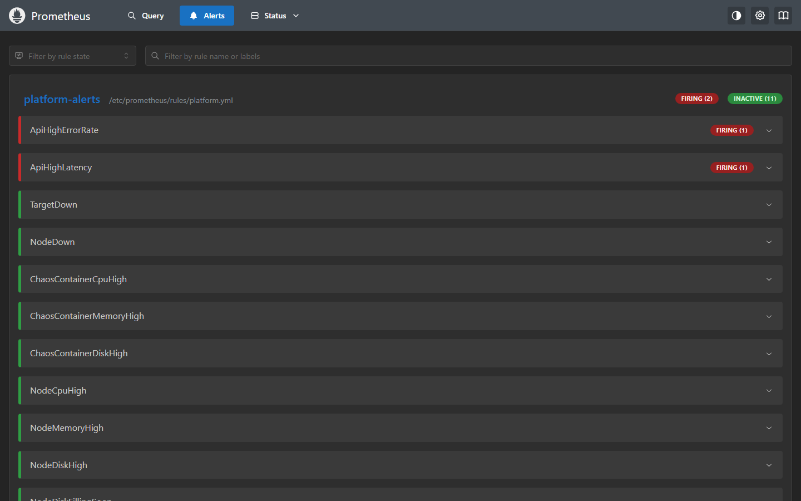

*Prometheus with `ApiHighErrorRate` and `ApiHighLatency` firing.*

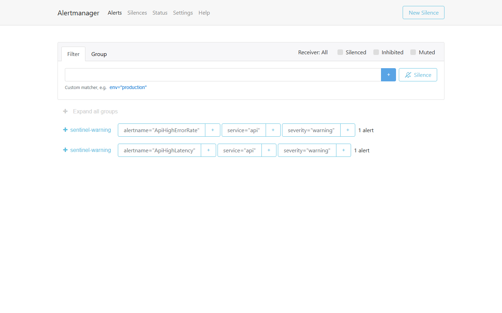

*Alertmanager groups the two alerts by name, service and severity and routes them to the warning receiver.*

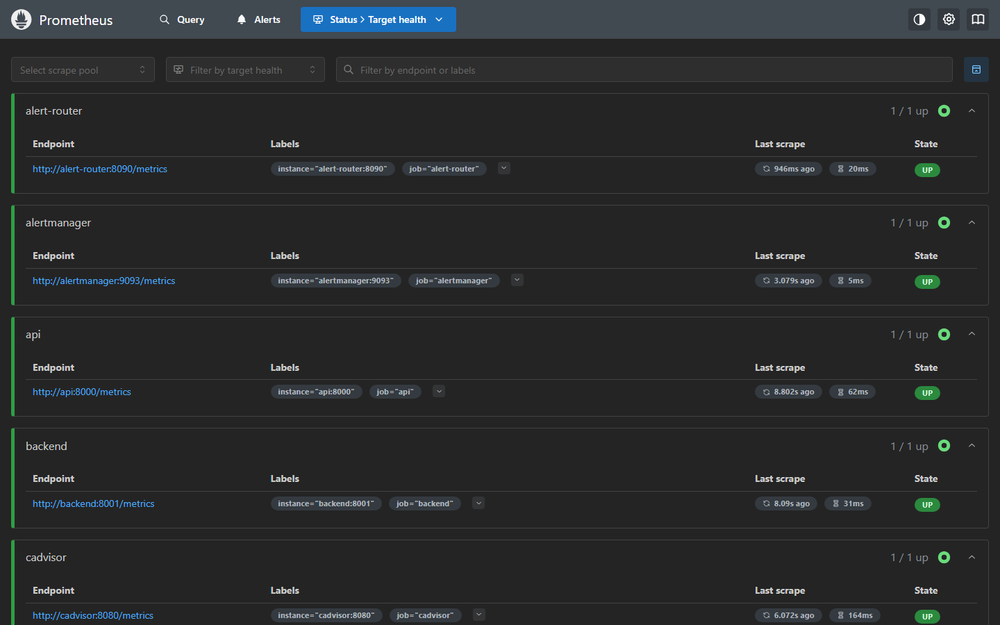

*Every scrape target up.*

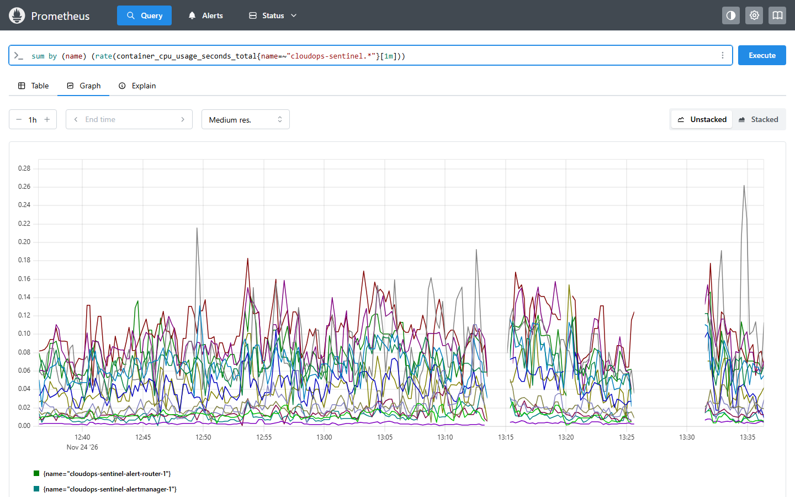

*cAdvisor CPU usage per container. The gaps are stack restarts.*

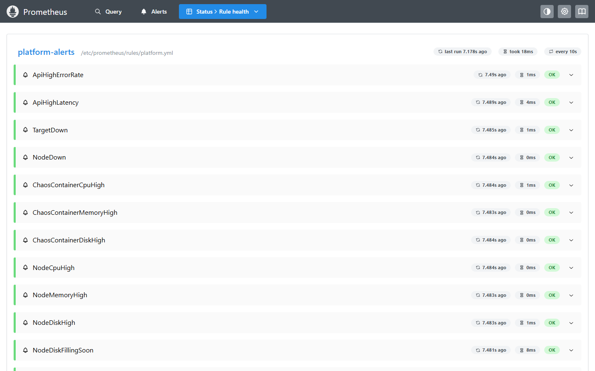

*Rule health for the platform alerts.*

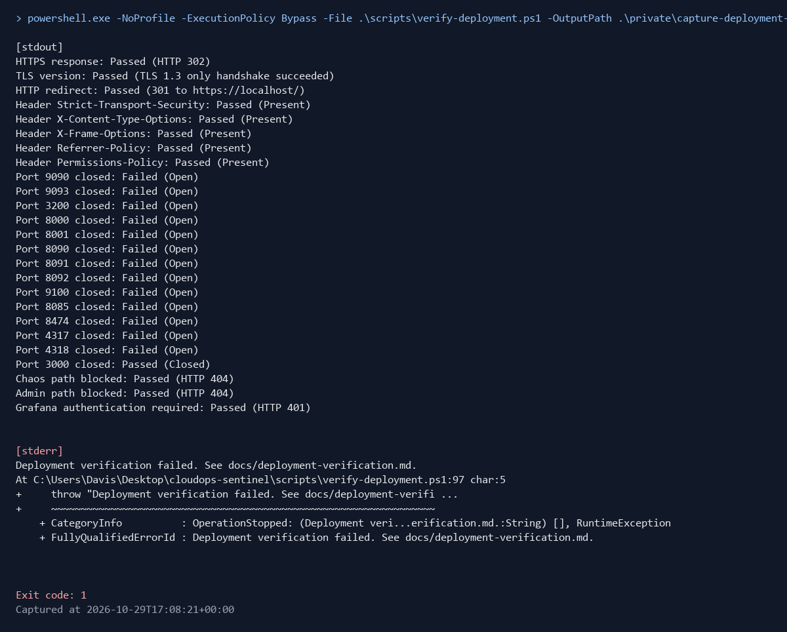

*Compose startup output from the deployment check.*

## Operations docs

- [Runbooks](docs/runbooks/)
- [SLO policy](docs/slo.md)
- [Incident management](docs/incident-management/)
- [Incident postmortem template](docs/incident-management/postmortem-template.md)
- [On-call handover](docs/oncall/handover-template.md)
- [Alerting and maintenance](docs/alerting.md)
- [Troubleshooting](docs/troubleshooting.md)
- [Documentation index](docs/README.md)

## Design decisions

- [Metrics and alerting stack](docs/adr/0001-metrics-and-alerting.md)
- [Dashboards as code](docs/adr/0002-dashboards-as-code.md)
- [Burn-rate SLO alerting](docs/adr/0003-burn-rate-slo-alerting.md)
- [Mocks in CI and manual live verification](docs/adr/0004-mocks-and-live-integrations.md)

## Testing and CI

The `checks` job runs pytest with coverage, Ruff, mypy, yamllint, style checks, dashboard and SLO rule drift checks, promtool rule checks and unit tests, amtool config and routing tests, Gitleaks on the tree and full history and Trivy on the service images. The `authorship-and-style` job checks public text. The `end-to-end` job runs the demo against the mocks. The `deployment` job starts the production-style stack behind Caddy and verifies it.

Run local checks with:

```powershell
.\.venv\Scripts\python.exe -m pytest
.\.venv\Scripts\python.exe -m ruff check .
.\.venv\Scripts\python.exe -m mypy
docker compose config --quiet
powershell.exe -NoProfile -ExecutionPolicy Bypass -File .\scripts\check-style.ps1
powershell.exe -NoProfile -ExecutionPolicy Bypass -File .\scripts\check-readme-images.ps1
```

After starting the stack with the Quick start commands, run the Prometheus and Alertmanager checks from [the CI workflow](.github/workflows/ci.yml).

## Security

The deployment is local and has no public endpoint. CI uses mock Slack and Jira integrations. The live run against real Slack and Jira was verified manually on the date in [the live verification record](docs/live-verification.md). In Docker Desktop, node-exporter measures the Linux VM rather than the Windows host. The production-style Compose configuration binds Caddy to localhost, disables anonymous Grafana access, requires a Grafana password and leaves internal service ports unpublished. This demonstration has not had an independent security review.

## Roadmap

Ideas beyond the current scope are in [docs/roadmap.md](docs/roadmap.md).

## License

MIT. See [LICENSE](LICENSE).
