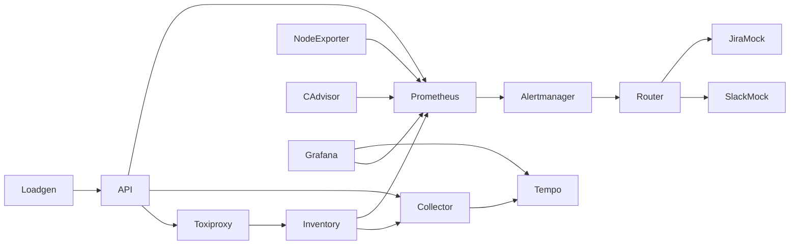

# CloudOps Sentinel
CloudOps Sentinel runs a monitored orders service with SLO alerting, tracing, chaos checks and local integration mocks.

## Quick start

1. Install Docker Desktop or Docker Engine with Docker Compose.
2. Copy `.env.example` to `.env` if you need to change local settings.
3. Run `docker compose up`.
4. Open Grafana at `http://localhost:3000` with `admin` and `sentinel-local`.
5. Run `.\scripts\demo.ps1` in PowerShell or `sh scripts/demo.sh` in a POSIX shell.

The local stack uses mock Slack and Jira services by default. `docker compose up` builds the service images and starts the platform.

The production-style deployment is local. Set `GRAFANA_ADMIN_PASSWORD` and `ROUTER_SHARED_TOKEN` in `.env`, set `INTEGRATION_MODE=mock` unless you intend to use real integrations then run `docker compose -f compose.prod.yml up -d --build`. Only Caddy publishes ports and it binds to localhost. CI is configured to verify the deployment end to end. No cloud deployment has been completed.

## Results

| Check | Status | Evidence |
|---|---|---|
| Unit tests and coverage | Passed | 19 tests and 83.67 percent coverage on 2026-10-27. |
| Ruff | Passed | `ruff check .` on 2026-10-27. |
| Mypy | Passed | `mypy` on 2026-10-27. |
| YAML lint | Passed | `yamllint -c yamllint.yml .` on 2026-10-27. |
| Style check | Passed | `scripts/check-style.ps1` ran on 2026-10-27. |
| Public source text | Passed | No prohibited terms were found in project files on 2026-10-27. |
| Dashboard and SLO generation | Passed | Generator drift tests ran as part of pytest. |
| Compose configuration | Passed | `docker compose config --quiet` on 2026-10-27. |
| Gitleaks project files | Passed | Nonignored project files had no findings on 2026-10-27. |
| Gitleaks full workspace | Not passed | A generic-key pattern remains in ignored generated Python dependency code. |
| Git history secret scan | Not passed | A historical environment example contains a credential finding. Rotate it if it was real. |
| Git history text check | Not passed | Existing internal history refs fail the message check and were not rewritten. |
| Docker Compose stack | Passed | All 14 services ran and configured health checks passed on 2026-10-27. |
| Prometheus rules and SLO tests | Passed | `promtool check rules` and `promtool test rules` ran in the pinned Prometheus image. |
| Alertmanager configuration and routing | Passed | `amtool check-config` and warning/critical route tests ran in the pinned Alertmanager image. |
| End-to-end mock demo | Passed | Readiness, API request, cross-service trace, latency alert and mock ticket/message verified on 2026-10-27. |
| Chaos: latency, errors, backend down and network delay | Passed | Real alert and mock integration results are recorded below. |
| cAdvisor candidate metrics | Passed locally | Temporary cAdvisor v0.60.6 exposed named container CPU metrics on Docker Desktop with the existing mounts. |
| Production-style deployment checks | Passed locally | HTTPS, TLS 1.3, redirect, headers, closed ports, blocked paths and Grafana authentication were checked on 2026-10-27. |
| Container resource alerts | Not verified | The deployed cAdvisor version still needs the separate upgrade. Alert firing remains unverified until the chaos scenarios pass. |
| Fresh clone | Not verified | A clean clone has not been tested. |
| Live Slack and Jira | Not fully verified | Successful Jira requests and Slack HTTP 200 responses were logged, but a complete verification record is unavailable. |
| CI workflows | Not verified | No workflow run exists. Production verification is configured for Linux CI. |

CI is configured to use mock integrations. Live verification is incomplete because a complete verification record is unavailable. See [docs/live-verification.md](docs/live-verification.md). The project has no successful workflow run yet.

## Integrations

The local path is Alertmanager alert, alert-router webhook, Slack mock message and Jira mock issue. Resolution adds a comment, moves the Jira issue to Done and sends a resolved message. CI uses mocks. Live Slack and Jira need manual verification with Jira Cloud and a Slack incoming webhook.

Real integration setup is in [docs/integrations.md](docs/integrations.md). Operational links: [SLO policy](docs/slo.md), [postmortem template](docs/incident-management/postmortem-template.md) and [on-call handover](docs/oncall/handover-template.md).

Capture files: [Slack alert](docs/images/slack-alert.png), [Jira ticket](docs/images/jira-ticket.png) and [resolved Jira ticket](docs/images/jira-resolved.png). The Slack incoming webhook does not return a message timestamp. The live script reports this limitation rather than inventing a value.

## SLO and alert reference

| Objective | Target | Window |
|---|---:|---|
| API availability | 99.5 percent | 30 days |
| API latency | 95 percent below 300 ms | 30 days |

| Alert | Severity | Runbook |
|---|---|---|
| ApiAvailabilityBurnCritical | Critical | [Runbook](docs/runbooks/ApiAvailabilityBurnCritical.md) |
| ApiAvailabilityBurnWarning | Warning | [Runbook](docs/runbooks/ApiAvailabilityBurnWarning.md) |
| ApiLatencyBurnWarning | Warning | [Runbook](docs/runbooks/ApiLatencyBurnWarning.md) |
| ApiHighErrorRate | Warning | [Runbook](docs/runbooks/ApiHighErrorRate.md) |
| ApiHighLatency | Warning | [Runbook](docs/runbooks/ApiHighLatency.md) |
| TargetDown | Critical | [Runbook](docs/runbooks/TargetDown.md) |
| NodeDown | Critical | [Runbook](docs/runbooks/NodeDown.md) |
| ChaosContainerCpuHigh | Warning | [Runbook](docs/runbooks/ChaosContainerCpuHigh.md) |
| ChaosContainerMemoryHigh | Warning | [Runbook](docs/runbooks/ChaosContainerMemoryHigh.md) |
| ChaosContainerDiskHigh | Warning | [Runbook](docs/runbooks/ChaosContainerDiskHigh.md) |
| NodeCpuHigh | Warning | [Runbook](docs/runbooks/NodeCpuHigh.md) |
| NodeMemoryHigh | Warning | [Runbook](docs/runbooks/NodeMemoryHigh.md) |
| NodeDiskHigh | Warning | [Runbook](docs/runbooks/NodeDiskHigh.md) |
| NodeDiskFillingSoon | Warning | [Runbook](docs/runbooks/NodeDiskFillingSoon.md) |
| PrometheusDown | Critical | [Runbook](docs/runbooks/PrometheusDown.md) |
| AlertmanagerDown | Critical | [Runbook](docs/runbooks/AlertmanagerDown.md) |

## Chaos results

| Scenario | Expected alert | Result |
|---|---|---|
| Latency | ApiHighLatency | Passed, alert 90.29 seconds after injection, ticket and message confirmed in 108.98 seconds. |
| Errors | ApiHighErrorRate | Passed, alert 70.18 seconds after injection, ticket and message confirmed in 88.84 seconds. |
| Backend killed | TargetDown | Passed, alert 80.39 seconds after injection, ticket and message confirmed in 80.45 seconds. |
| CPU stress | ChaosContainerCpuHigh | Not verified. Candidate cAdvisor v0.60.6 returned named CPU metrics in an isolated test. |
| Memory pressure | ChaosContainerMemoryHigh | Not verified. Candidate cAdvisor v0.60.6 returned named CPU metrics in an isolated test. |
| Disk fill | ChaosContainerDiskHigh | Not verified. Candidate cAdvisor v0.60.6 returned named CPU metrics in an isolated test. |
| Network delay | ApiHighLatency | Passed, alert 90.34 seconds after injection, ticket and message confirmed in 109.11 seconds. |

Results from successful real runs are stored in [artifacts/chaos-results/](artifacts/chaos-results/). Capture steps and redaction guidance are in [docs/screenshots.md](docs/screenshots.md).

Silencing and the scheduled maintenance mute are documented in [docs/alerting.md](docs/alerting.md).

## Security controls and limits

The API chaos endpoint requires a token, the router checks an authorization header, images use fixed version tags and application containers run as a non-root user with a read-only root filesystem where supported. Credentials belong in ignored `.env` or GitHub secrets. This configuration is a demonstration and has not been independently reviewed.

On Docker Desktop, node-exporter measures the Linux VM and not Windows. The configured cAdvisor v0.49.2 did not return per-container samples on this host. A temporary v0.60.6 test with the existing mounts returned named CPU metrics. Container resource alerts remain unverified. The local production-style deployment binds only to localhost. CI is configured to verify it on Linux. Local integration mocks are in-memory and reset when restarted. Chaos alerts need enough traffic and time to evaluate. Local demo tokens are not for shared environments.

See [local deployment](docs/deployment.md) and [troubleshooting](docs/troubleshooting.md) for deployment controls and cAdvisor diagnostics.

## Project layout

| Path | Purpose |
|---|---|
| `app/` | Orders API, inventory service, alert router and mock receivers |
| `compose.prod.yml` and `Caddyfile` | Local production-style deployment and Grafana-only proxy |
| `monitoring/` | Prometheus rules, Alertmanager, Grafana, Tempo and collector configuration |
| `chaos/` | Scenario specifications and runner |
| `docs/` | SLO, integrations, runbooks, screenshots and incident operations |
| `scripts/` | Demo, live verification and generation helpers |
| `tests/` | Unit and configuration tests |
| `artifacts/` | Measured chaos results and scorecard |

## Roadmap

See [docs/roadmap.md](docs/roadmap.md) for work that remains planned or unverified.

## License

MIT. See [LICENSE](LICENSE).
