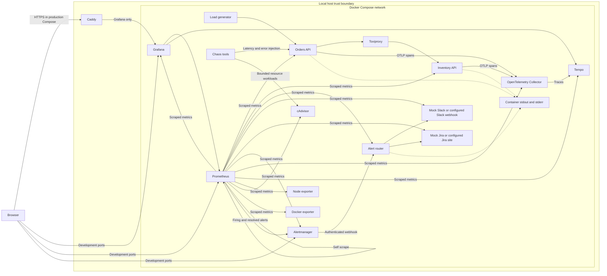
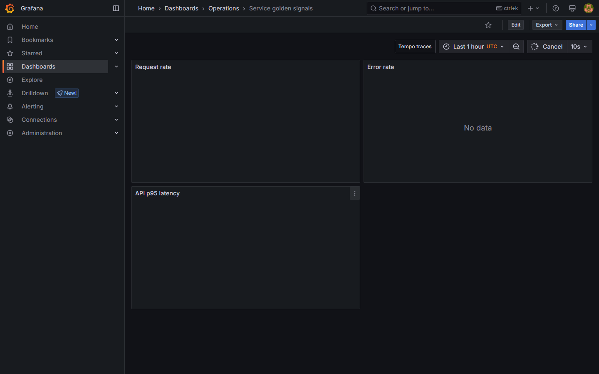
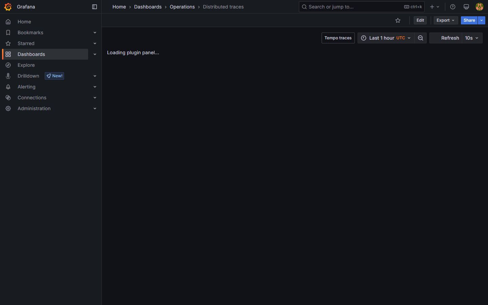
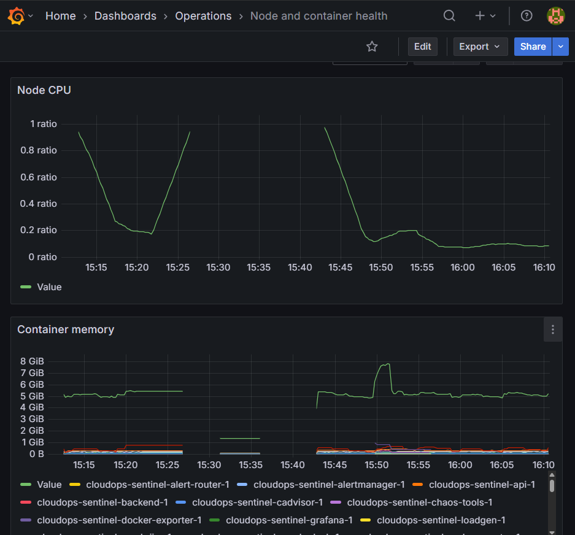
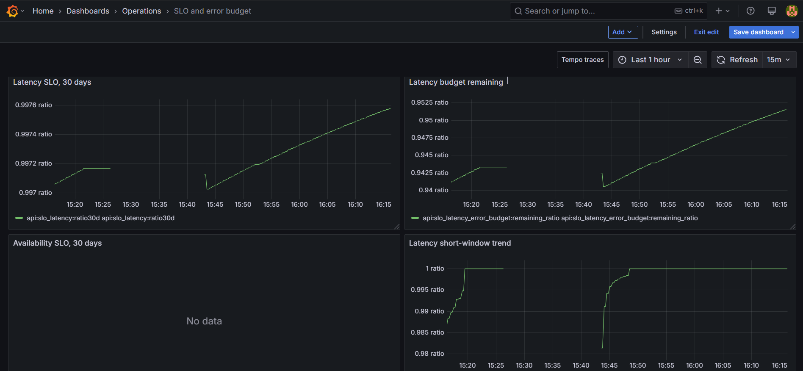
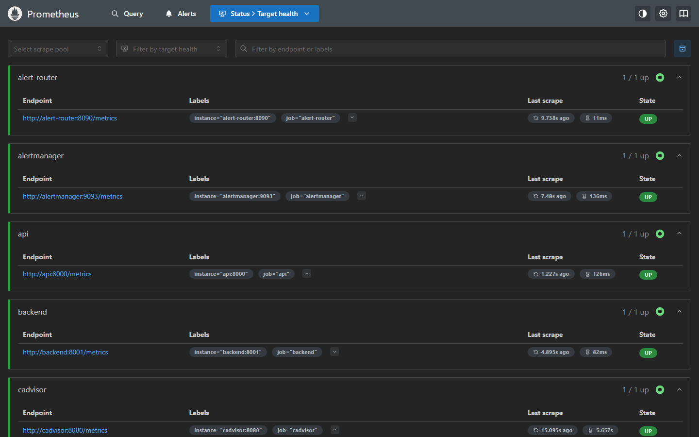
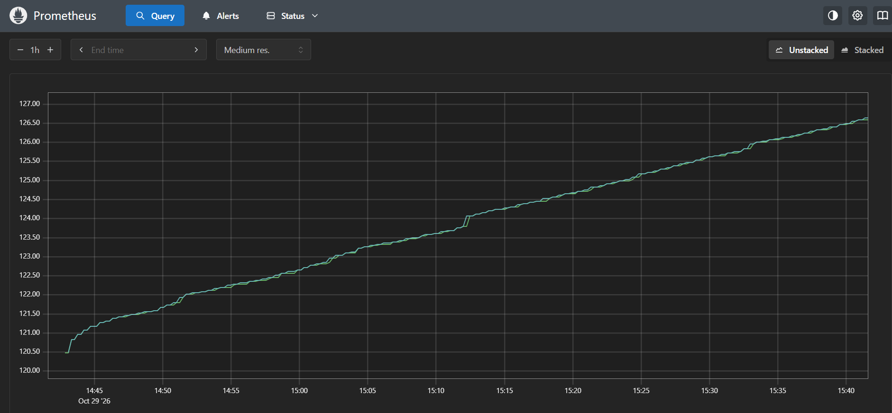
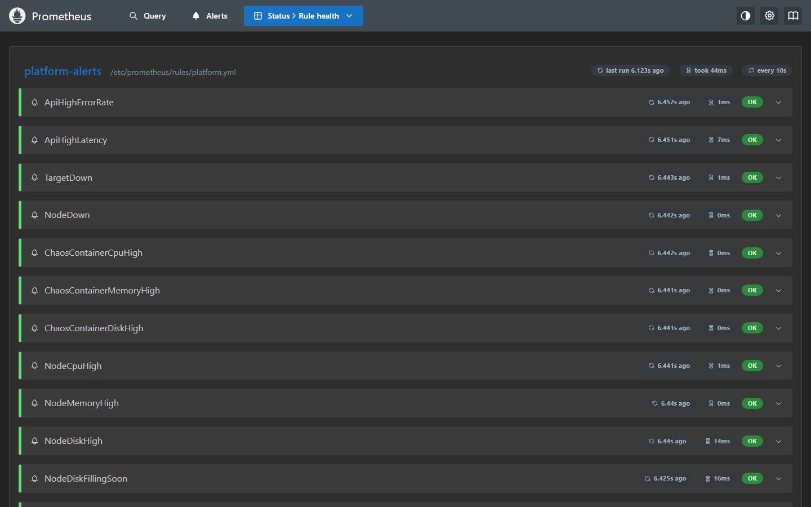
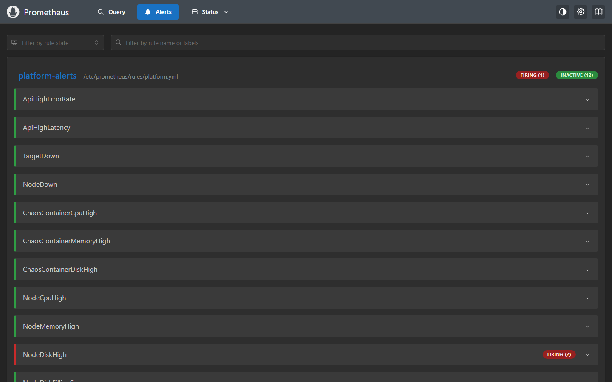
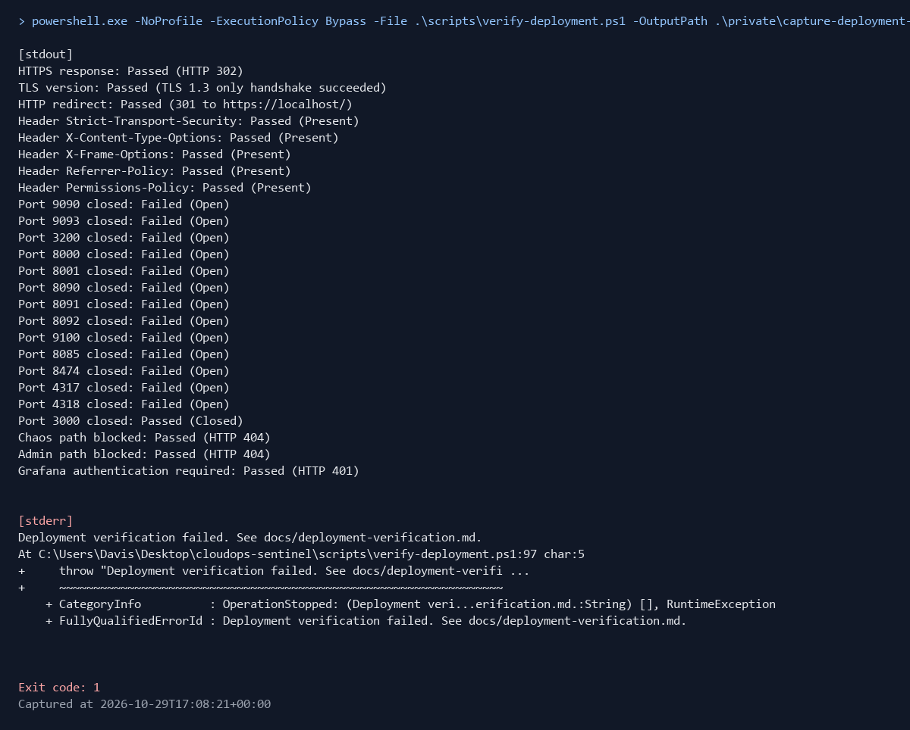

# CloudOps Sentinel

CloudOps Sentinel is a local operations demonstration of metrics, SLO alerting, tracing and incident response.

## Workflow status

No workflow badge is shown because no workflow run is recorded.

## Problem

Teams need to connect service health signals to operational response. This project shows how service metrics, traces and SLO alerts can help identify faults. The local chaos runner exercises those signals. Slack and Jira use local mocks by default.

## Architecture



In the production-style Compose configuration Caddy is the only service that publishes host ports. The development configuration publishes service ports for local testing.

## Quick start

Run these three commands from a clean clone in PowerShell. Docker Compose and Python are required.

```powershell
Copy-Item .env.example .env
py -m venv .venv; .\.venv\Scripts\python.exe -m pip install -r requirements-dev.txt
powershell.exe -NoProfile -ExecutionPolicy Bypass -File .\scripts\demo.ps1
```

Expected output: the demo waits for API readiness, checks a cross-service trace, runs the latency scenario and prints Compose service status. The recorded fresh-checkout run completed these checks with mock Slack and Jira.

## How it works

### Metrics and dashboards as code

The API and inventory services expose Prometheus request counters and latency histograms. Prometheus scrapes application and infrastructure targets. Python definitions using the Grafana Foundation SDK generate provisioned dashboards for golden signals, SLOs, node and container health and traces.

### SLOs and burn-rate alerts

The repository SLO specification sets API availability to 99.5 percent over 30 days and latency to 95 percent of requests under 300 ms over 30 days. Prometheus recording rules calculate rolling objective ratios and remaining budgets. Multi-window burn-rate rules alert on sustained budget use.

### Alert routing to Slack and Jira

Prometheus sends firing and resolved notifications to Alertmanager. Alertmanager groups alerts and sends authenticated webhooks to the router. The router deduplicates Jira issues by fingerprint, sends Slack Block Kit messages and updates issues on repeat firing or resolution. CI and the default local configuration use mocks.

Mock mode always directs requests to local mock receivers even when real integration URLs are present in `.env`.

### Tracing

The API calls inventory through Toxiproxy. Both services export OpenTelemetry spans to the collector and then to Tempo. API latency histogram exemplars link to traces in Grafana.

### Chaos experiments

The runner injects API latency and errors, stops the inventory service or applies bounded CPU, memory, disk and network faults. It checks the expected alert and integrations, records elapsed times and exits unsuccessfully when a required check fails.

## Results

The table uses recorded local runs. The runner records alert time from injection and one shared polling time when both Slack and Jira checks pass. Separate delivery times for Slack and Jira are not recorded.

| Scenario and date | Alert | Alert after injection | Slack confirmation | Jira confirmation |
|---|---|---:|---|---|
| Latency, 2026-10-27 | ApiHighLatency | 85.26 seconds | Shared poll at 103.63 seconds | Shared poll at 103.63 seconds |
| Latency, 2026-10-28 fresh checkout | ApiHighLatency | 75.27 seconds | Shared poll at 94.08 seconds | Shared poll at 94.08 seconds |
| Latency, 2026-10-29 | ApiHighLatency | Not observed | Not recorded | Not recorded |
| Errors, 2026-10-27 | ApiHighErrorRate | 70.18 seconds | Shared poll at 88.84 seconds | Shared poll at 88.84 seconds |
| Backend killed, 2026-10-27 | TargetDown | 80.39 seconds | Shared poll at 80.45 seconds | Shared poll at 80.45 seconds |
| Network delay, 2026-10-27 | ApiHighLatency | 90.34 seconds | Shared poll at 109.11 seconds | Shared poll at 109.11 seconds |
| CPU stress, 2026-10-29 | ChaosContainerCpuHigh | 107.89 seconds | Shared poll at 132.34 seconds | Shared poll at 132.34 seconds |
| Memory pressure, 2026-10-29 | ChaosContainerMemoryHigh | 241.79 seconds | Shared poll at 266.44 seconds | Shared poll at 266.44 seconds |
| Disk fill, 2026-10-27 | ChaosContainerDiskHigh | Not observed | Not recorded | Not recorded |

The 2026-10-29 latency and disk-fill runs failed to confirm their expected alerts. The latest local test run on 2026-10-29 passed 25 tests with 83.92 percent coverage. A fresh-checkout test run on 2026-10-28 passed 22 tests with the same coverage. Current checks are recorded in [the scorecard](artifacts/scorecard.md).

## Screenshots

The gallery uses the original selected screenshots. Automated captures are listed separately in the [image status list](docs/images/README.md).



*Grafana golden signals. The error-rate panel had no recorded data in this capture.*



*Grafana trace rates for the API and inventory services.*



*Grafana node CPU and container memory metrics.*



*Grafana SLO and remaining latency budget. The availability panel had no recorded data in this capture.*



*Prometheus target health page.*



*Prometheus container CPU metrics.*



*Prometheus platform alert rules.*



*Prometheus alert page. This captured alert is NodeDiskHigh, despite the existing image filename.*



*Compose startup output from the original deployment capture.*

## Operations docs

- [Runbooks](docs/runbooks/)
- [SLO policy](docs/slo.md)
- [Incident management](docs/incident-management/)
- [On-call handover](docs/oncall/handover-template.md)
- [Alerting and maintenance](docs/alerting.md)
- [Troubleshooting](docs/troubleshooting.md)
- [Documentation index](docs/README.md)

## Design decisions

- [Metrics and alerting stack](docs/adr/0001-metrics-and-alerting.md)
- [Dashboards as code](docs/adr/0002-dashboards-as-code.md)
- [Burn-rate SLO alerting](docs/adr/0003-burn-rate-slo-alerting.md)
- [Mocks in CI and manual live verification](docs/adr/0004-mocks-and-live-integrations.md)

## Testing and CI

The configured CI workflow runs tests, Ruff, mypy, YAML lint, style checks, dashboard drift checks, Prometheus and Alertmanager checks, secret scans, image scans and a production-style end-to-end check. No workflow run is recorded.

Run local checks with:

```powershell
.\.venv\Scripts\python.exe -m pytest
.\.venv\Scripts\python.exe -m ruff check .
.\.venv\Scripts\python.exe -m mypy
docker compose config --quiet
powershell.exe -NoProfile -ExecutionPolicy Bypass -File .\scripts\check-style.ps1
powershell.exe -NoProfile -ExecutionPolicy Bypass -File .\scripts\check-readme-images.ps1
```

After starting the stack with the Quick start commands, run the Prometheus and Alertmanager checks from [the CI workflow](.github/workflows/ci.yml).

## Security

The deployment is local and has no public endpoint. CI uses mock Slack and Jira integrations. A manual live exercise on 2026-10-27 recorded successful Jira requests and Slack HTTP 200 responses, but complete end-to-end live verification is not documented in [the live verification record](docs/live-verification.md). In Docker Desktop, node-exporter measures the Linux VM rather than the Windows host. The production-style Compose configuration binds Caddy to localhost, disables anonymous Grafana access, requires a Grafana password and leaves internal service ports unpublished. This demonstration has not had an independent security review.

## Roadmap

### Planned

- Capture screenshots only after confirming that the view contains useful recorded data.
- Complete a documented live Slack and Jira verification.
- Re-run the disk chaos scenario and record whether its alert fires.

## License

MIT. See [LICENSE](LICENSE).
