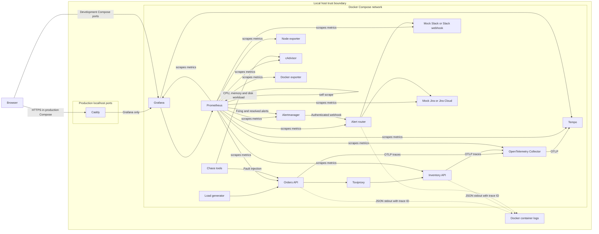

# CloudOps Sentinel

CloudOps Sentinel is a local operations demo for service metrics, SLO alerting, tracing and incident response.

## Workflow status

No workflow badges are shown because no workflow run is recorded.

## Problem

Service teams need a way to connect request health signals to operational actions. This project demonstrates how metrics, traces, SLO alerts and fault injection can support that work. Slack and Jira default to local mocks so the workflow can run without external accounts.

## Architecture



In the production-style Compose configuration, only Caddy publishes host ports. The development Compose configuration publishes service ports for local testing.

## Quick start

Run these commands from a clean clone in PowerShell. Docker Desktop or Docker Engine with Compose and Python are required.

```powershell
Copy-Item .env.example .env
py -m venv .venv; .\.venv\Scripts\python.exe -m pip install -r requirements-dev.txt
powershell.exe -NoProfile -ExecutionPolicy Bypass -File .\scripts\demo.ps1
```

Expected output: the demo reports API readiness, cross-service trace verification and a completed latency scenario, then prints the Compose service status. The stack uses mock Slack and Jira.

## How it works

### Metrics and dashboards as code

The API and inventory services expose Prometheus request counters and latency histograms. Prometheus scrapes the application and infrastructure targets. Python code using the Grafana Foundation SDK generates provisioned dashboards for golden signals, SLOs, node and container health and traces.

### SLOs and burn-rate alerts

The API availability objective is 99.5 percent over 30 days. The latency objective is 95 percent of requests under 300 ms over 30 days. Recording rules track the rolling objectives and remaining budgets. Multi-window burn-rate rules alert on sustained budget consumption.

### Alert routing to Slack and Jira

Prometheus sends firing and resolved notifications to Alertmanager. Alertmanager groups alerts and sends authenticated webhooks to the router. The router deduplicates Jira tickets by fingerprint, sends Slack Block Kit messages and updates issues on repeat or resolution. CI and the default local configuration use mocks.

Mock mode always directs traffic to the local mock receivers even when real integration URLs are present in `.env`.

### Tracing

The API calls the inventory service through Toxiproxy. Both services export OpenTelemetry spans to the collector and then to Tempo. Latency histogram exemplars link to traces in Grafana.

### Chaos experiments

The scenario runner injects API latency and errors, stops the backend or applies bounded CPU, memory, disk and network faults. It checks the expected alert and integrations, records elapsed times and returns a failing exit code when a required check fails.

## Results

Recorded local chaos runs below are from 2026-10-27 and 2026-10-28. The 2026-10-28 latency run came from a fresh checkout. The runner records alert time from fault injection and one shared polling time when Slack and Jira checks have both succeeded. It does not record separate Slack and Jira delivery times.

| Scenario and run date | Alert | Alert after injection | Slack and Jira confirmation after injection |
|---|---|---:|---:|
| Latency, 2026-10-27 | ApiHighLatency | 85.26 seconds | 103.63 seconds, both confirmed |
| Latency, 2026-10-28 fresh checkout | ApiHighLatency | 75.27 seconds | 94.08 seconds, both confirmed |
| Errors, 2026-10-27 | ApiHighErrorRate | 70.18 seconds | 88.84 seconds, both confirmed |
| Backend killed, 2026-10-27 | TargetDown | 80.39 seconds | 80.45 seconds, both confirmed |
| Network delay, 2026-10-27 | ApiHighLatency | 90.34 seconds | 109.11 seconds, both confirmed |
| CPU stress, 2026-10-27 | ChaosContainerCpuHigh | Not observed | Not confirmed |
| Memory pressure, 2026-10-27 | ChaosContainerMemoryHigh | Not observed | Not confirmed |
| Disk fill, 2026-10-27 | ChaosContainerDiskHigh | Not observed | Not confirmed |

The test run on 2026-10-28 passed 22 tests with 83.92 percent coverage. The three resource alerts remain unverified. Local chaos result files are ignored and may contain account-specific result data.

## Screenshots

No screenshots have been captured. Expected screenshots and capture steps are listed in [docs/screenshots.md](docs/screenshots.md). The demo GIF is also not present.

## Operations docs

- [Runbooks](docs/runbooks/)
- [SLO policy](docs/slo.md)
- [Incident management](docs/incident-management/)
- [On-call handover](docs/oncall/handover-template.md)
- [Alerting and maintenance](docs/alerting.md)
- [Local deployment](docs/deployment.md)
- [Troubleshooting](docs/troubleshooting.md)
- [Documentation index](docs/README.md)

## Project layout

- `app/`: API, inventory, alert router and mock receivers.
- `monitoring/`: Prometheus rules, Grafana provisioning and dashboards.
- `chaos/`: fault scenarios and their runner.
- `scripts/`: setup, verification and dashboard tooling.
- `docs/`: architecture, operations procedures and recorded evidence.
- `tests/`: service, alerting and chaos-runner tests.

## Design decisions

- [Metrics and alerting stack](docs/adr/0001-metrics-and-alerting.md)
- [Dashboards as code](docs/adr/0002-dashboards-as-code.md)
- [Burn-rate SLO alerting](docs/adr/0003-burn-rate-slo-alerting.md)
- [Mocks in CI and manual live verification](docs/adr/0004-mocks-and-live-integrations.md)

## Testing and CI

CI is configured to verify the local deployment end to end and run pytest, Ruff, mypy, YAML lint, style checks, dashboard drift checks, Prometheus and Alertmanager validation, secret scans and image scans. No workflow run has been recorded.

Run Python checks locally with:

```powershell
.\.venv\Scripts\python.exe -m pytest
.\.venv\Scripts\python.exe -m ruff check .
.\.venv\Scripts\python.exe -m mypy
docker compose config --quiet
powershell.exe -NoProfile -ExecutionPolicy Bypass -File .\scripts\check-style.ps1
powershell.exe -NoProfile -ExecutionPolicy Bypass -File .\scripts\check-readme-images.ps1
```

After the Quick start command starts the stack, validate Prometheus and Alertmanager with:

```powershell
docker compose exec -T prometheus promtool check rules /etc/prometheus/rules/slo.yml /etc/prometheus/rules/platform.yml
docker compose exec -T prometheus promtool test rules /etc/prometheus/rules/slo.test.yml
docker compose exec -T alertmanager amtool check-config /etc/alertmanager/alertmanager.yml
docker compose exec -T alertmanager amtool config routes test --config.file=/etc/alertmanager/alertmanager.yml --verify.receivers=sentinel-critical alertname=Smoke severity=critical service=api
```

The workflow also runs YAML lint, dashboard drift checks, secret scans, image scans and a production-style end-to-end check. See [the CI workflow](.github/workflows/ci.yml) for those invocations.

## Security

The deployment is local. No cloud or public deployment has been done. The production-style local deployment binds Caddy to localhost, disables anonymous Grafana access, requires a password from `.env`, blocks chaos and admin paths and leaves internal service ports unpublished. The API chaos control requires a token. Application services use read-only filesystems where configured. The project is a demonstration and has not been independently reviewed.

CI uses mocks. Manual live Slack and Jira verification on 2026-10-27 was partial: successful Jira requests and Slack HTTP 200 responses were observed, but a complete end-to-end verification record is unavailable. See [docs/live-verification.md](docs/live-verification.md). On Docker Desktop, node-exporter measures the Linux VM rather than Windows. cAdvisor v0.60.6 returned named container CPU and memory samples on the recorded local host, but container resource alert firing remains unverified.

## Roadmap

Planned items are listed in [docs/roadmap.md](docs/roadmap.md).

## License

MIT. See [LICENSE](LICENSE).
