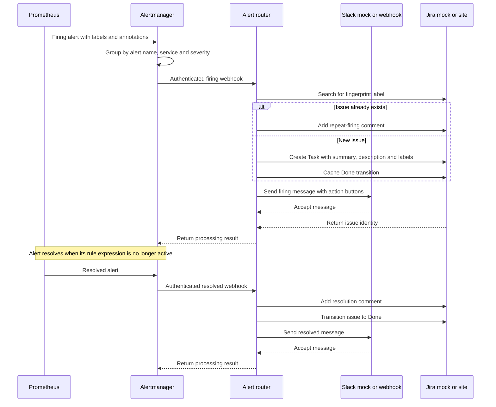

# Alerting flow

The flow uses local mocks by default. Live endpoints require explicit environment configuration.

Alertmanager groups by alert name, service and severity. The configured repeat interval is four hours. The router applies a Jira issue creation limit and retries transient Jira errors and Slack rate limits. The router caches the Jira Done transition when it creates an issue and applies that transition when the alert resolves. See [alerting.md](alerting.md) for silences and the maintenance mute.
