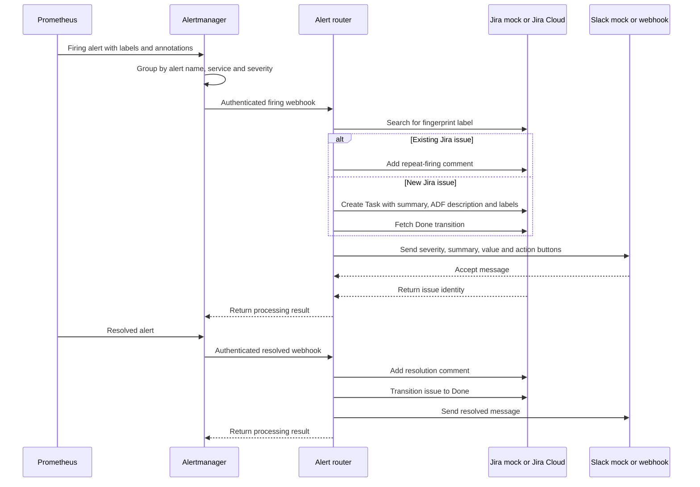

# Alerting flow

The flow uses the configured local mocks unless the environment explicitly selects live integrations.

Alertmanager groups by alert name, service and severity. Its configured repeat interval is four hours. The router applies the Jira creation limit and retries transient Jira errors and Slack rate limits. See [alerting.md](alerting.md) for silences and the scheduled maintenance mute.
