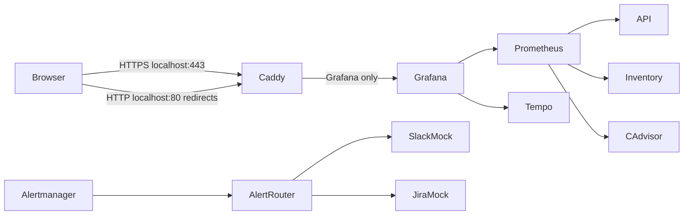

# Local deployment

This deployment runs the platform on one host. Caddy is the only service with published ports. It binds HTTPS on `127.0.0.1:443` and HTTP on `127.0.0.1:80`. Application and monitoring services share the private Compose network and have no published ports. Caddy proxies only Grafana.



## Controls

- Caddy terminates local TLS with an internal certificate and accepts TLS 1.3 only.
- Caddy redirects HTTP to HTTPS and sets security response headers.
- Caddy limits request bodies to 10 MiB.
- Requests to `/chaos` and admin paths return 404. Caddy does not proxy those paths.
- Grafana anonymous access and self-service account creation are disabled.
- Set a unique `GRAFANA_ADMIN_PASSWORD` in the ignored `.env` file before starting the deployment. No default password is configured in this deployment.
- Only Caddy publishes ports. Prometheus, Alertmanager, Tempo, the API, inventory, alert-router and mocks are not published to the host.
- Slack and Jira use local mocks by default. Live integrations require explicit configuration.

## Start the deployment

Create `.env` from `.env.example`, set `GRAFANA_ADMIN_PASSWORD` and `ROUTER_SHARED_TOKEN`. Set `INTEGRATION_MODE=mock` unless you intend to use real integrations. Then start the stack:

```powershell
docker compose -f compose.prod.yml up -d --build
.\scripts\verify-deployment.ps1
```

Open [https://localhost](https://localhost) and sign in as `admin` with the password from `.env`.

## Trust the local certificate

Caddy stores its local root certificate in the `caddy-data` volume. Export it with:

```powershell
docker compose -f compose.prod.yml cp caddy:/data/caddy/pki/authorities/local/root.crt .\caddy-local-root.crt
Import-Certificate -FilePath .\caddy-local-root.crt -CertStoreLocation Cert:\CurrentUser\Root
```

Trust this certificate only on devices that need to access this local deployment. Remove the exported file after importing it.

## Limitations

This is a single-host deployment with no high availability, no backups and no public URL. The internal certificate is local to this deployment. The mock integrations store in-memory state. The storage driver can affect cAdvisor container metrics.

## Roadmap

Local follow-up items are listed in [the project roadmap](roadmap.md).
