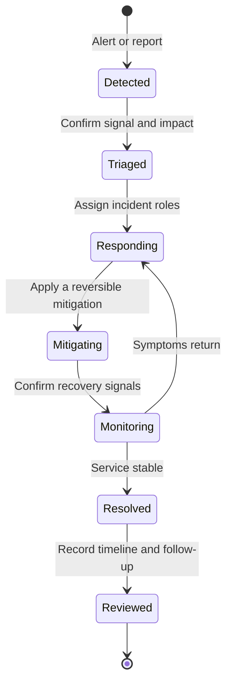

# Incident lifecycle

Use the [severity matrix](severity-matrix.md) to set response priority. Assign an incident commander, communications lead and operations lead. Use the [communication templates](communication-templates.md) during response and the [postmortem template](postmortem-template.md) after resolution.
