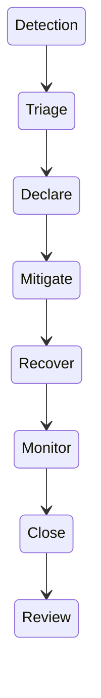

# Severity matrix and response roles

| Severity | Example impact | Initial response |
|---|---|---|
| SEV1 | Broad customer impact or critical service unavailable | Page primary on-call and assign an incident commander. |
| SEV2 | Material feature degradation or sustained SLO burn | Page service owner and start a shared incident channel. |
| SEV3 | Limited impact with a safe workaround | Create an issue and track during the current shift. |

## Roles

- Incident commander sets priorities, assigns roles and records decisions.
- Communications lead prepares internal and customer updates.
- Operations lead investigates, mitigates and reports technical status.

## Lifecycle

Use the [communication templates](communication-templates.md) during the incident and the [postmortem template](postmortem-template.md) after service recovery.

